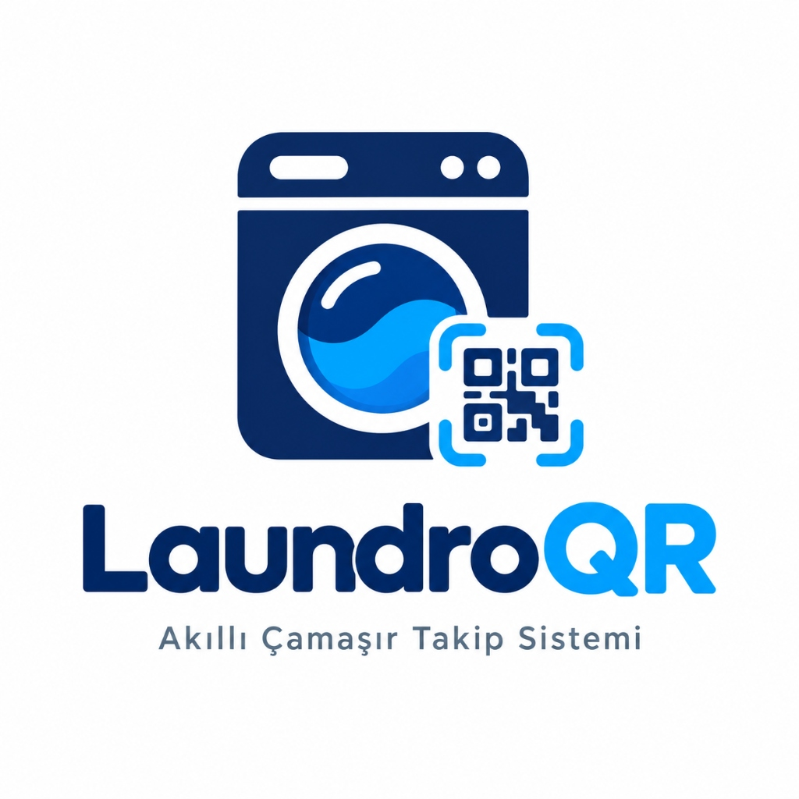

<p align="center">
  
</p>

<h1 align="center">LaundroQR</h1>
<p align="center">
  <strong>Smart Laundry Management System for Dormitories &amp; Co-living Spaces</strong>
</p>

<p align="center">
  <a href="https://nextjs.org/"></a>
  <a href="https://flutter.dev/"></a>
  <a href="https://supabase.com/"></a>
  <a href="https://admin-beta-navy.vercel.app/"></a>
  <a href="https://dashing-capybara-ac1036.netlify.app/"></a>
</p>

---

## 🚀 Live Demos & Investor Pitch Deck

Experience the fully deployed, cloud-connected LaundroQR ecosystem in your browser:

- 📱 **Resident App (Flutter Web):** [dashing-capybara-ac1036.netlify.app](https://dashing-capybara-ac1036.netlify.app/)
- 💻 **Admin Dashboard (Next.js):** [admin-beta-navy.vercel.app](https://admin-beta-navy.vercel.app/)
- 📊 **Investor Pitch Deck (PDF):** [docs/LaundroQR_Pitch_Deck.pdf](docs/LaundroQR_Pitch_Deck.pdf)

---

## ✨ Key Features & Phase 1–10 Engineering Highlights

- 🔒 **Multi-Tenant Architecture & Row Level Security (RLS):** Strict tenant isolation across all PostgreSQL tables (`organizations`, `buildings`, `laundry_rooms`, `machines`, `memberships`, `machine_sessions`, `maintenance_tickets`, `credits`, `audit_logs`). University and KYK dormitories operate in completely isolated security boundaries.
- ⚡ **Atomic Session Lifecycle & Concurrency Protection:** Server-authoritative timestamps and partial unique indexing (`uq_one_active_session_per_machine`) paired with `FOR UPDATE` row-level locking prevent double-booking and race conditions when two residents scan the same QR code simultaneously.
- 🏷️ **Honest State Labeling (`status_source`):** Clearly distinguishes between software timer estimates (`software`), resident/staff reports (`user_report`), and hardware telemetry (`sensor`). Completing a timer transitions a machine to `cycle_complete` (*Awaiting Unload*) rather than falsely claiming it is physically empty.
- 🔄 **Cryptographic QR Rotation & Audit Trail:** Dormitory staff and administrators can rotate compromised or worn machine QR UUIDs in one click with full `audit_logs` traceability.
- 🔌 **IoT & Smart Relay Webhooks (`/api/iot`):** Hardware-ready webhook endpoint designed to trigger ESP32 / Arduino smart relays over HTTP/MQTT using per-machine IP and MAC addressing.
- 🔔 **Push Notifications (Firebase Cloud Messaging):** Integrated `NotificationService` (`firebase_core` & `firebase_messaging`) for cycle-completion alerts and maintenance updates.
- 💳 **Resident Wallet & Sandbox Payment Gateway:** Built-in `credits` ledger with atomic top-up RPC (`add_wallet_funds`) and an interactive Flutter `WalletScreen` supporting Iyzico / Stripe sandbox top-ups.
- 🤖 **CI/CD & Automated Android Release Pipeline:** GitHub Actions workflows for secret hygiene, SQL policy verification, Next.js typechecking/Vitest suite, Flutter widget tests, and automated Android `.apk` release builds.

---

## 🏗️ Monorepo Architecture

```
LAUNDROQR/
├── apps/
│   ├── admin/           # Next.js 15 (App Router) + TypeScript Institutional Admin Dashboard
│   └── mobile/          # Flutter 3.44 Resident App (Android, iOS & Web)
├── supabase/
│   ├── config.toml      # Supabase CLI & Auth configuration
│   ├── migrations/      # Ordered SQL schema, RLS policies, IoT & Wallet RPCs
│   ├── seed.sql         # Multi-tenant non-production demo seed data
│   └── tests/           # Transactional RLS & concurrency verification suite
├── docs/                # PRD, Architecture, Database, Security, Roadmap & Pitch Deck PDF
└── .github/workflows/   # Automated CI checks & Android Release APK workflow
```

---

## 🛠️ Quick Local Setup

```bash
# 1. Clone the repository
git clone https://github.com/mertturkel234/LAUNDROQR.git
cd LAUNDROQR

# 2. Run the Next.js Admin Panel (http://localhost:3000)
cd apps/admin
npm install
npm run dev

# 3. Run the Flutter Resident App (in a separate terminal)
cd apps/mobile
flutter pub get
flutter run -d chrome
```

---

## 📚 Technical Documentation

- [Product Requirements Document (PRD)](docs/PRD.md)
- [System Architecture](docs/ARCHITECTURE.md)
- [Database Schema & Migrations](docs/DATABASE.md)
- [Security & Multi-Tenant RLS Model](docs/SECURITY.md)
- [Development Roadmap](docs/ROADMAP.md)
- [Test Plan & Verification Strategy](docs/TEST_PLAN.md)
- [Architecture Decision Records (ADR)](docs/DECISIONS.md)
- [Pilot Readiness & Deployment Guide](docs/PILOT_AND_DEPLOYMENT.md)

---

## 📄 License

Distributed under the [MIT License](LICENSE). Built by **Mert Türkel**.
